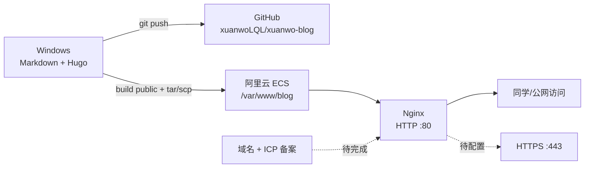

# 漩涡博客构建详细过程

> 本文记录从零搭建 **漩涡（xuanwo）** 博客并部署到公网的实际过程。
> 当前阶段：HTTP 已上线；HTTPS 等待域名和 ICP 备案完成后配置。
> 文中不记录 SSH 密码、Token、私钥内容等敏感信息。

## 1. 最终结果

| 项目 | 当前值 |
| --- | --- |
| 博客名称 | 漩涡 |
| 副标题 | 记录代码、安全与思考 |
| 作者 | xuanwo |
| 当前访问地址 | <http://47.93.123.112/> |
| GitHub 仓库 | <https://github.com/xuanwoLQL/xuanwo-blog> |
| GitHub 账号 | `xuanwoLQL` |
| 生成器 | Hugo Extended 0.168.0 |
| 主题 | PaperMod master 快照 |
| Web 服务器 | Nginx 1.24.0（Ubuntu） |
| 服务器系统 | Ubuntu 24.04.5 LTS |
| 服务器地域 | 阿里云北京 |
| 站点目录 | `/var/www/blog` |
| Nginx 配置 | `/etc/nginx/sites-available/blog` |
| 最新提交 | `2b0d0d2 Document live deployment status` |
| HTTPS | 未配置，等待域名和 ICP 备案 |

### 架构



## 2. 技术选型

最终选择：

```text
Hugo + PaperMod + Nginx
```

选择原因：

- Hugo 生成纯静态文件，不需要数据库和运行时。
- 1.7 GB 内存的 ECS 运行 Nginx 和静态站点非常轻量。
- 静态博客攻击面比 WordPress、Halo 等动态博客小。
- 文章使用 Markdown 编写，适合 Obsidian、VS Code 和 Git 管理。
- PaperMod 自带搜索、归档、标签、阅读时间、代码复制、目录和深色模式。
- GitHub 保存源码，服务器只保存构建结果，二者职责清晰。

没有选择 WordPress 的原因：

- 1.7 GB 内存、没有 Swap 的环境下，PHP + MySQL 偏重。
- 插件、后台登录和上传功能会扩大攻击面。
- 对个人技术博客来说，静态发布已经足够。

## 3. 项目目录

```text
博客的构建/
├─ hugo.yaml
├─ content/
│  ├─ _index.md
│  ├─ about.md
│  ├─ archives.md
│  ├─ search.md
│  └─ posts/
│     ├─ _index.md
│     └─ hello-xuanwo.md
├─ assets/css/extended/zz-xuanwo.css
├─ static/
│  ├─ images/profile.png
│  ├─ images/og-cover.png
│  ├─ favicon.svg
│  ├─ favicon-16x16.png
│  ├─ favicon-32x32.png
│  ├─ apple-touch-icon.png
│  └─ safari-pinned-tab.svg
├─ themes/PaperMod/
├─ nginx/blog
├─ scripts/generate-assets.py
├─ scripts/build-upload.sh
├─ scripts/build-upload.ps1
├─ docs/previews/
├─ README.md
└─ THEME_VERSION.md
```

关键文件：

- [hugo.yaml](hugo.yaml)：站点主配置。
- [content/_index.md](content/_index.md)：首页内容后备。
- [content/about.md](content/about.md)：关于页。
- [assets/css/extended/zz-xuanwo.css](assets/css/extended/zz-xuanwo.css)：视觉定制。
- [nginx/blog](nginx/blog)：Nginx 安全配置。
- [scripts/build-upload.ps1](scripts/build-upload.ps1)：Windows 构建上传。
- [scripts/build-upload.sh](scripts/build-upload.sh)：Bash 构建上传。
- [README.md](README.md)：使用说明。

## 4. 环境信息

### 本地

- Windows + PowerShell
- Git 2.55.x
- Hugo Extended 0.168.0
- Edge Headless 用于桌面端、移动端和 CSP 验证
- Python + Pillow 用于生成占位头像、图标和 Open Graph 封面

### 服务器

- 阿里云 ECS
- 公网 IP：`47.93.123.112`
- 系统：Ubuntu 24.04.5 LTS
- vCPU：2
- 内存：约 1.7 GB
- 磁盘：40 GB
- 地域：`cn-beijing`
- 安全组：已放行 TCP `22/80/443`
- SSH：密钥登录

### 主题版本

PaperMod 使用 `master` 快照：

```text
commit: 118119693d8b5ac211b939775678310973bcb232
date:   2026-10-25T06:23:51Z
```

不直接使用 PaperMod v8.0 发布包的原因：

- v8.0 的 Open Graph 模板仍调用旧的 `partials/...` 路径。
- Hugo 0.168 不再接受这种旧调用方式，构建时会报：

```text
partial "partials/templates/_funcs/get-page-images" not found
```

- 当前 `master` 已改为使用 `_partials/...` 结构，并能通过 Hugo 0.168 构建。

## 5. 公网与端口检查

首先确认不能把本机出口 IP 当作博客服务器：

- Windows 本机出口公网 IP 属于运营商 NAT，不适合直接对外提供 Web 服务。
- 真正用于建站的是阿里云 ECS 的公网 IP。

检查 80/443：

```powershell
$target = "47.93.123.112"
foreach ($port in 80, 443) {
    $client = [System.Net.Sockets.TcpClient]::new()
    try {
        $task = $client.ConnectAsync($target, $port)
        if ($task.Wait(3000) -and $client.Connected) {
            "$port OPEN"
        } else {
            "$port TIMEOUT"
        }
    } finally {
        $client.Dispose()
    }
}
```

最初只有 22 端口可达，80/443 超时；在阿里云安全组放行后，80/443 恢复可达。

> [!warning]
> 当前 Nginx 只监听 80。443 端口虽然在安全组中放行，但没有 TLS 证书和 HTTPS server block，访问 HTTPS 仍不可用。

## 6. 本地创建 Hugo 项目

### 6.1 安装 Hugo Extended

```powershell
winget install Hugo.Hugo.Extended
hugo version
```

需要查看输出中是否包含：

```text
+extended
```

### 6.2 准备主题

主题已内置在：

```text
themes/PaperMod/
```

因此构建时不需要临时下载主题。版本记录见 [THEME_VERSION.md](THEME_VERSION.md)。

## 7. Hugo 主配置说明

完整配置见 [hugo.yaml](hugo.yaml)。

关键配置：

```yaml
baseURL: "http://47.93.123.112/"
title: "漩涡"
theme: ["PaperMod"]
locale: "zh-CN"
defaultContentLanguage: "zh"
params:
  defaultTheme: dark
  disableThemeToggle: false
```

### 7.1 中文和路径

```yaml
locale: "zh-CN"
defaultContentLanguage: "zh"
hasCJKLanguage: true
timeZone: "Asia/Shanghai"
permalinks:
  posts: "/posts/:year/:month/:slug/"
```

日期格式：

```yaml
params:
  DateFormat: "2006-01-02"
```

### 7.2 Profile 首页

```yaml
profileMode:
  enabled: true
  title: "漩涡 · xuanwo"
  subtitle: "网络安全学生，记录 CTF Writeups、漏洞复现与技术折腾。以授权为前提，保持好奇，认真复盘。"
  imageUrl: "images/profile.png"
  imageWidth: 180
  imageHeight: 180
  buttons:
    - name: 阅读文章
      url: posts/
    - name: 关于我
      url: about/
```

PaperMod 的 Profile Mode 会在首页展示头像、标题、简介、社交图标和按钮。

### 7.3 顶部导航

```yaml
menu:
  main:
    - identifier: home
      name: 首页
      url: /
    - identifier: archives
      name: 归档
      url: /archives/
    - identifier: tags
      name: 标签
      url: /tags/
    - identifier: search
      name: 搜索
      url: /search/
    - identifier: about
      name: 关于
      url: /about/
```

### 7.4 搜索

PaperMod 搜索依赖首页 JSON 索引：

```yaml
outputs:
  home:
    - HTML
    - RSS
    - JSON
```

搜索页位于 `content/search.md`，必须使用：

```yaml
layout: "search"
```

### 7.5 阅读时间、代码复制与目录

```yaml
params:
  ShowReadingTime: true
  ShowWordCount: true
  ShowCodeCopyButtons: true
  ShowToc: true
  TocOpen: false
```

文章 Front Matter 中也可以单独覆盖：

```yaml
ShowToc: true
TocOpen: false
```

## 8. 页面内容

### 8.1 首页

首页内容文件：[content/_index.md](content/_index.md)

注意：启用 Profile Mode 后，首页主要由 `hugo.yaml` 中的 `profileMode` 渲染；`_index.md` 的正文主要用于非 Profile 模式和内容兜底。

### 8.2 关于页

关于页：[content/about.md](content/about.md)

当前联系方式：

- GitHub：<https://github.com/xuanwoLQL>
- RSS：`/index.xml`

### 8.3 示例文章

示例文章：

```text
content/posts/hello-xuanwo.md
```

用于验证：

- 阅读时间
- 自动目录
- 代码复制
- 标签
- 分类
- 系列
- 搜索索引

## 9. 视觉定制

完整样式见 [assets/css/extended/zz-xuanwo.css](assets/css/extended/zz-xuanwo.css)。

设计方向：

- 默认深色，辅助浅色模式。
- 主色使用青绿色，辅色使用金色。
- 不使用大面积紫色。
- 深色背景使用径向渐变，而不是单一纯色。
- 首页 Profile 在桌面端采用头像左、文字右的网格布局。
- 移动端改为居中单列布局。
- 阅读正文使用中文字体栈，标题和导航使用无衬线字体。
- 代码块覆盖 PaperMod 原有紫色语法高亮，改为青绿/金色配色。
- 通过 `prefers-reduced-motion` 尊重系统减少动画设置。

### 9.1 PaperMod 新主题机制

当前 PaperMod 使用：

```html
<html data-theme="dark">
```

而不是旧版本的：

```html
<body class="dark">
```

因此自定义 CSS 使用：

```css
:root[data-theme="dark"] {
    --theme: #0b1211;
    --primary: #edf7f2;
    --accent: #5eead4;
}
```

如果继续使用旧的 `body.dark` 选择器，会出现：

- 页面正文已经变暗。
- 头部和 Profile 卡片仍是浅色。
- 白色文字落在浅色背景上，几乎不可读。

### 9.2 移动端导航

移动端把导航改为两行：

1. Logo + 主题切换按钮。
2. 首页、归档、标签、搜索、关于。

并设置：

```css
.nav {
    flex-direction: column;
}

#menu {
    max-width: 100%;
    justify-content: space-between;
}
```

### 9.3 静态图片资源

资源生成脚本：

```text
scripts/generate-assets.py
```

生成：

- `profile.png`
- `favicon-16x16.png`
- `favicon-32x32.png`
- `apple-touch-icon.png`
- `og-cover.png`

生成命令：

```powershell
D:\PBox-full\python3\python.exe `
  "D:\Program Files\Obsidian\zuodebiji\网络安全笔记\博客的构建\scripts\generate-assets.py"
```

## 10. 本地构建与验收

### 10.1 本地预览

```powershell
cd "D:\Program Files\Obsidian\zuodebiji\网络安全笔记\博客的构建"
hugo server -D
```

浏览器打开：

```text
http://127.0.0.1:1313/
```

### 10.2 生产构建

```powershell
hugo --gc --minify --cleanDestinationDir `
  --baseURL "http://47.93.123.112/"
```

构建结果：

| 指标 | 结果 |
| --- | --- |
| 页面数 | 28 |
| 输出文件 | 43 |
| 空文件 | 0 |
| 站内链接检查 | 285 个 |
| 缺失站内链接 | 0 |

### 10.3 视觉验收

已检查：

- 1440px 桌面端
- 390px 移动端
- 深色模式
- 浅色模式
- 首页 Profile
- 文章页 TOC
- 代码块
- 搜索页
- 关于页

预览文件位于：

```text
docs/previews/
```

> Edge Headless 直接使用 `--window-size=390,1000` 时，Windows 上实际布局视口可能仍大于 390px。真实移动端验收应使用 DevTools Protocol 的 `Emulation.setDeviceMetricsOverride`，而不是只看截图尺寸。

## 11. GitHub 上传

### 11.1 身份与隐私

Git 提交使用：

```text
user.name  = xuanwoLQL
user.email = 290020931+xuanwoLQL@users.noreply.github.com
```

博客页面展示真实联系邮箱，但 Git 提交历史使用 GitHub noreply 邮箱，避免真实邮箱进入公开提交记录。

### 11.2 创建仓库

仓库名：

```text
xuanwo-blog
```

地址：

```text
https://github.com/xuanwoLQL/xuanwo-blog
```

通过 GitHub API 创建空仓库，再在本地初始化并推送。

> [!caution]
> 不要把 Personal Access Token 写入文件、命令历史、脚本或 Git remote URL。
> 本次通过 Git Credential Manager 读取已有凭据，只用于 API 请求和 Git 推送。

### 11.3 本地提交

```powershell
$repo = "D:\Program Files\Obsidian\zuodebiji\网络安全笔记\博客的构建"

git -C $repo init -b main
git -C $repo config user.name "xuanwoLQL"
git -C $repo config user.email "290020931+xuanwoLQL@users.noreply.github.com"
git -C $repo config core.quotepath false

git -C $repo add -A
git -C $repo commit -m "Initial Hugo blog with PaperMod and secure Nginx deployment"
git -C $repo remote add origin "https://github.com/xuanwoLQL/xuanwo-blog.git"
git -C $repo push -u origin main
```

### 11.4 提交前检查

本次提交 155 个文件，没有提交：

- `.deploy.env`
- `public/`
- `__pycache__/`
- 私钥
- Token

`public/` 和 `.deploy.env` 已写入 `.gitignore`。

当前仓库状态：

```text
main
2b0d0d2 Document live deployment status
working tree clean
```

## 12. 服务器部署

### 12.1 安装 Nginx

```bash
sudo apt update
sudo apt install -y nginx
```

本次安装版本：

```text
nginx/1.24.0 (Ubuntu)
```

### 12.2 创建目录

```bash
sudo install -d -o root -g www-data -m 0755 /var/www/blog
sudo install -d -o root -g root -m 0755 /var/www/certbot
```

### 12.3 安装站点配置

```bash
sudo cp nginx/blog /etc/nginx/sites-available/blog
sudo ln -sfn /etc/nginx/sites-available/blog /etc/nginx/sites-enabled/blog

if [ -L /etc/nginx/sites-enabled/default ]; then
    sudo unlink /etc/nginx/sites-enabled/default
fi

sudo nginx -t
sudo systemctl enable nginx
sudo systemctl restart nginx
sudo systemctl is-active nginx
```

### 12.4 上传静态站点

Windows 推荐：

```powershell
$env:HUGO_BIN = "C:\path\to\hugo.exe"
$env:SSH_KEY = "C:\path\to\deploy_key"
$env:DEPLOY_USER = "root"
$env:DEPLOY_HOST = "47.93.123.112"
$env:DEPLOY_PATH = "/var/www/blog"
$env:BASE_URL = "http://47.93.123.112/"

.\scripts\build-upload.ps1
```

PowerShell 脚本流程：

1. Hugo 构建。
2. 将 `public/` 打包为 tar.gz。
3. SCP 上传到服务器 `/tmp`。
4. SSH 解压到 `/var/www/blog`。
5. 设置目录 `755`、文件 `644`。
6. 验证 `index.html` 存在。

Bash 版脚本支持 `rsync --delete`，会清理服务器上的旧构建文件：

```bash
cp .deploy.env.example .deploy.env
# 编辑 .deploy.env
bash scripts/build-upload.sh
```

### 12.5 文件权限

```bash
find /var/www/blog -type d -exec chmod 755 {} +
find /var/www/blog -type f -exec chmod 644 {} +
```

## 13. Nginx 安全加固

完整配置：[nginx/blog](nginx/blog)

### 13.1 隐藏文件和备份

```nginx
location ~ /\.(?!well-known(?:/|$)) {
    return 404;
}

location ~* \.(?:bak|backup|old|orig|copy|save|swp|swo|tmp|sql|sqlite|sqlite3|db|dump|zip|rar|7z|tar|tgz|gz|bz2|xz|map)$ {
    return 404;
}
```

覆盖：

- `.git`
- `.env`
- `.svn`
- `.bak`
- `.zip`
- `.sql`
- `.dump`
- `.tar.gz`
- source map

`.well-known/acme-challenge/` 单独放行，供 Certbot HTTP-01 验证使用。

### 13.2 常见扫描路径

```nginx
location ~* ^/(?:wp-admin|wp-login\.php|xmlrpc\.php|phpmyadmin|pma|admin|manager|login)(?:/|$) {
    return 404;
}
```

这个站点不是 WordPress/PHP 应用，因此这些请求统一返回 404，减少扫描噪音。

### 13.3 基础限流

```nginx
limit_req_zone $binary_remote_addr zone=blog_req:10m rate=16r/s;
limit_conn_zone $binary_remote_addr zone=blog_conn:10m;
limit_req_status 429;
limit_conn_status 429;
```

server 中：

```nginx
limit_req zone=blog_req burst=32 nodelay;
limit_conn blog_conn 24;
```

限流只能减轻自动化扫描和低质量请求压力，不能替代 WAF 或 DDoS 防护。

### 13.4 缓存

| 类型 | 策略 |
| --- | --- |
| HTML | `expires -1`，每次重新验证 |
| `index.json` | 不缓存，保证搜索索引及时更新 |
| CSS / JS / 字体 | 1 年 |
| 图片 / 图标 | 30 天 |
| RSS / sitemap / robots | 1 小时 |

### 13.5 安全响应头

```nginx
add_header X-Content-Type-Options "nosniff" always;
add_header X-Frame-Options "DENY" always;
add_header Referrer-Policy "strict-origin-when-cross-origin" always;
add_header Permissions-Policy "camera=(), microphone=(), geolocation=(), payment=(), usb=()" always;
add_header Cross-Origin-Opener-Policy "same-origin" always;
```

CSP 当前使用：

```nginx
add_header Content-Security-Policy "default-src 'self'; base-uri 'self'; object-src 'none'; frame-ancestors 'none'; form-action 'self'; img-src 'self' data:; style-src 'self' 'unsafe-inline'; script-src 'self' 'unsafe-inline'; font-src 'self' data:; connect-src 'self';" always;
```

PaperMod 的主题切换使用内联脚本，因此暂时需要 `'unsafe-inline'`。后续可将内联脚本改为 nonce 或 hash，进一步收紧 CSP。

### 13.6 隐藏 Nginx 版本

```nginx
server_tokens off;
```

实际公网响应：

```text
Server: nginx
```

而不是：

```text
Server: nginx/1.24.0 (Ubuntu)
```

## 14. 公网验收

### 14.1 HTTP 状态

| 路径 | 状态 |
| --- | --- |
| `/` | 200 |
| `/about/` | 200 |
| `/search/` | 200 |
| `/archives/` | 200 |
| `/posts/2026/10/hello-xuanwo/` | 200 |
| `/index.json` | 200 |
| `/images/profile.png` | 200 |

### 14.2 受限路径

| 路径 | 状态 |
| --- | --- |
| `/.env` | 404 |
| `/.git/config` | 404 |
| `/backup.zip` | 404 |
| `/dump.sql` | 404 |
| `/wp-login.php` | 404 |

### 14.3 浏览器验收

使用 Edge DevTools Protocol 对公网页面实际检查：

```text
title: 漩涡
theme: dark
menu: 首页 / 归档 / 标签 / 搜索 / 关于
profile image: loaded, 360 px
favicon: loaded
theme toggle: dark -> light -> dark
search keyword "Hugo": 2 results
post TOC: yes
code copy button: yes
network failures: 0
JavaScript exceptions: 0
```

当前截图预览：

- [首页桌面版](docs/previews/home-desktop.png)
- [首页移动版](docs/previews/home-mobile.png)
- [浅色模式](docs/previews/home-light.png)
- [文章页](docs/previews/post-desktop.png)
- [移动端关于页](docs/previews/about-mobile.png)

## 15. 实际踩坑记录

### 15.1 PaperMod v8.0 与 Hugo 0.168

现象：

```text
partial "partials/templates/_funcs/get-page-images" not found
```

原因：

- v8.0 发布包的模板仍使用旧路径。
- Hugo 0.168 对 partial 路径规则更严格。

解决：

- 切换到 PaperMod `master`。
- 锁定提交 `118119693d8b5ac211b939775678310973bcb232`。
- 更新 `THEME_VERSION.md`。

### 15.2 深色模式头部仍然是浅色

现象：

- 页面主体是深色。
- 导航栏和 Profile 卡片是浅色。
- 白色文字几乎不可读。

原因：

- PaperMod 新版把主题状态写在 `<html data-theme="dark">`。
- 自定义 CSS 仍然使用旧的 `body.dark` 选择器。

解决：

```css
:root[data-theme="dark"] {
    /* 深色变量 */
}

:root[data-theme="dark"] header.header {
    background: rgba(11, 18, 17, 0.80);
}
```

### 15.3 远程 Bash 收到 CRLF

现象：

```text
Invalid unit name "nginx\r"
```

原因：

- Windows PowerShell 通过管道向远程 `bash -s` 传入多行字符串时带入了 CRLF。
- `systemctl` 把 `\r` 当成了服务名的一部分。

解决：

- 简单命令改为单行 SSH 命令。
- 不支持时，先把部署脚本上传为文件，再在服务器执行。
- 不直接通过 PowerShell 管道向 Bash 发送复杂多行脚本。

### 15.4 Windows SSH 私钥权限过宽

现象：

```text
WARNING: UNPROTECTED PRIVATE KEY FILE!
Permissions for ... are too open.
```

原因：

- OpenSSH 拒绝使用权限过宽的 Windows 私钥。

解决：

- 将私钥复制到临时目录。
- 使用 `icacls` 只授予当前用户读取权限。
- 部署结束后删除临时副本。
- 不在文档中记录私钥路径或内容。

### 15.5 静态资源和 Hugo 构建并行

现象：

- 构建输出中的 `apple-touch-icon.png` 为 0 字节。

原因：

- 生成资源与 Hugo 构建并行执行，Hugo 复制文件时资源尚未写完。

解决：

- 先生成静态资源。
- 确认资源文件大小正常。
- 再执行 Hugo 构建。

### 15.6 移动端截图未使用真实视口

现象：

- 用 Edge `--window-size=390,1000` 截图时，移动端导航似乎被截断。

原因：

- Windows Headless Edge 存在最小窗口宽度，截图尺寸不等于 CSS 布局视口。

解决：

- 使用 DevTools Protocol：

```javascript
Emulation.setDeviceMetricsOverride({
  width: 390,
  height: 1000,
  deviceScaleFactor: 1,
  mobile: true
})
```

## 16. 日常更新流程

### 16.1 新建文章

```powershell
cd "D:\Program Files\Obsidian\zuodebiji\网络安全笔记\博客的构建"
hugo new content posts/your-post.md
```

编辑 Markdown 后：

```powershell
hugo server -D
```

### 16.2 提交 GitHub

```powershell
git status --short
git add -A
git commit -m "Add new post: your-post"
git push
```

### 16.3 发布到服务器

Git Bash：

```bash
bash scripts/build-upload.sh
```

PowerShell：

```powershell
.\scripts\build-upload.ps1
```

### 16.4 每次发布后的检查

```powershell
Invoke-WebRequest "http://47.93.123.112/" -UseBasicParsing
Invoke-WebRequest "http://47.93.123.112/index.json" -UseBasicParsing
```

服务器端：

```bash
nginx -t
systemctl status nginx --no-pager
tail -n 50 /var/log/nginx/blog.error.log
```

## 17. 安全清单

- [x] 只公开 HTTP 80；443 等待 TLS 配置
- [x] 隐藏 Nginx 版本号
- [x] 禁止访问隐藏文件和备份文件
- [x] 限制每 IP 请求频率和并发连接
- [x] 设置基础安全响应头和 CSP
- [x] GitHub 不提交 `.deploy.env`
- [x] Git 提交使用 GitHub noreply 邮箱
- [x] 静态站点无数据库
- [ ] 域名 ICP 备案
- [ ] HTTPS / Certbot
- [ ] HSTS
- [ ] 独立非 root 部署用户
- [ ] 限制 SSH 来源 IP
- [ ] 自动备份和可用性监控

## 18. 后续计划

### 18.1 域名和 HTTPS

1. 注册或确定博客域名。
2. 在阿里云完成 ICP 备案。
3. 添加 DNS A 记录指向 `47.93.123.112`。
4. 修改 `hugo.yaml`：

```yaml
baseURL: "https://blog.example.com/"
```

5. 重新构建和上传。
6. 安装 Certbot：

```bash
sudo apt install -y certbot python3-certbot-nginx
sudo certbot --nginx -d blog.example.com
```

7. 检查 HTTPS 后，再考虑开启 HSTS。

### 18.2 SSH 加固

建议后续：

- 创建 `blogdeploy` 普通用户。
- 将部署目录所有权交给 `blogdeploy`。
- 禁止 root 直接登录 SSH。
- 仅保留密钥认证。
- 必要时限制 SSH 来源 IP。

### 18.3 备份

至少备份：

- `content/`
- `hugo.yaml`
- `assets/`
- `static/`
- `nginx/blog`
- GitHub 仓库

服务器目录 `/var/www/blog` 是构建产物，可以由源码重新生成，不需要作为唯一备份。

## 19. 常用命令速查

```powershell
# 本地预览
hugo server -D

# 生产构建
hugo --gc --minify --cleanDestinationDir --baseURL "http://47.93.123.112/"

# GitHub
git status --short
git add -A
git commit -m "update"
git push

# 发布
.\scripts\build-upload.ps1
```

```bash
# 服务器 Nginx
sudo nginx -t
sudo systemctl reload nginx
sudo systemctl status nginx --no-pager

# 日志
sudo tail -f /var/log/nginx/blog.access.log
sudo tail -f /var/log/nginx/blog.error.log
```

## 20. 当前结论

博客已经完成从本地构建、GitHub 版本管理、阿里云 Nginx 部署到公网访问的完整链路。

当前可以通过以下地址访问：

```text
http://47.93.123.112/
```

下一阶段的核心工作不是继续堆功能，而是：

1. 绑定正式域名。
2. 完成 ICP 备案。
3. 启用 HTTPS。
4. 加固 SSH 和备份策略。

