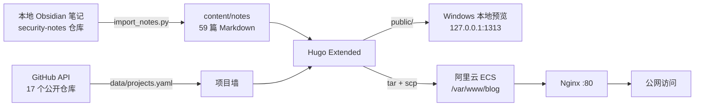

# 漩涡博客构建记录 2：视觉重构与内容入库

> 本文记录 **漩涡（xuanwo）** 博客第二阶段的改造：从 PaperMod 默认 Profile 首页，升级为自定义粒子漩涡首页、项目墙与笔记库，并把 GitHub 项目与本地安全笔记整理进站。
>
> 当前访问地址：<http://47.93.123.112/>
>
> 本文不记录 SSH 密码、Token、私钥内容或私钥路径。

## 1. 本阶段结果

| 项目 | 结果 |
| --- | --- |
| 线上地址 | <http://47.93.123.112/> |
| 部署时间 | 2026-10-26 23:38（服务器本地时间） |
| 页面 | 首页、项目、项目详情、笔记、文章、归档、标签、分类、系列、搜索、关于、404 |
| 笔记 | 59 篇 |
| 项目 | 17 个公开仓库，其中 6 个重点项目有详情页 |
| 专题 | 9 个 |
| 构建 | Hugo Extended 0.168.0 |
| 生成页面 | 311 个（含分类 / 标签 / 系列与别名） |
| 静态产物体积 | 约 5.8 MB |
| CSS / JS | 约 77 KB / 14 KB（minify 后） |
| 搜索索引 | 约 427 KB，67 条 |
| RSS | 改为摘要输出，`index.xml` 约 23 KB |
| HTTPS | 未配置，按要求暂不处理 |

### 架构



## 2. 起点与目标

### 2.1 旧版的问题

第一版是标准的 PaperMod Profile 首页：

- 一张居中的玻璃卡片，四周留白很大，视觉重心单一
- 首页只有 1 篇文章，内容密度低
- 项目、笔记没有入口
- 文章页还是 PaperMod 默认排版，缺少阅读进度、系列导航、相关笔记
- 移动端和大屏的观感都比较「模板化」

### 2.2 本阶段目标

1. **视觉上要有记忆点**：不再是默认模板，首页要能一眼记住
2. **内容要撑起来**：把 GitHub 项目与本地安全笔记整理进站
3. **阅读体验要完整**：目录、进度、代码复制、系列、相关推荐
4. **内容边界要清楚**：只放公开可发布的内容
5. **不能引入过重的前端依赖**：静态站点保持轻量

### 2.3 明确的约束

- 域名和 HTTPS 暂不处理
- **OpenHarmony 笔记不收录**
- 作者后续确认：`xuanwo` 仓库可以上传，作为项目卡片列出
- 本地笔记只挑选适合公开的部分
- 先本地预览，确认后再部署

## 3. 技术方案

仍然使用：

```text
Hugo + PaperMod + Nginx
```

但不再依赖 PaperMod 的 Profile 模式，而是在项目内覆盖模板与视觉层：

```text
PaperMod 负责：构建、搜索、归档、代码高亮、基础 SEO
项目内负责：首页、文章页、笔记页、项目页、导航、页脚、CSS、JS
```

选择原因：

- 不引入 React / Vue / Tailwind，避免构建链和运行时
- Canvas、滚动揭示、筛选、目录高亮全部用原生 JS
- 内容用 Markdown，继续兼容 Obsidian
- 静态产物仍可直接扔给 Nginx

## 4. 项目目录

```text
博客的构建/
├─ hugo.yaml
├─ content/
│  ├─ _index.md
│  ├─ about.md
│  ├─ archives.md
│  ├─ search.md
│  ├─ tags/_index.md
│  ├─ categories/_index.md
│  ├─ series/_index.md
│  ├─ notes/                       # 59 篇笔记 + _index.md
│  ├─ projects/                    # 6 个重点项目详情 + _index.md
│  └─ posts/hello-xuanwo.md
├─ data/projects.yaml              # 17 个公开项目卡片
├─ layouts/
│  ├─ index.html                   # 粒子漩涡首页
│  ├─ _default/single.html         # 文章页
│  ├─ notes/list.html              # 笔记库
│  ├─ projects/list.html           # 项目墙
│  ├─ projects/single.html         # 项目详情
│  ├─ _partials/
│  │  ├─ header.html
│  │  ├─ footer.html
│  │  ├─ vortex-mark.html
│  │  ├─ collection-icon.html
│  │  ├─ cat-slug.html
│  │  ├─ extend_head.html
│  │  └─ extend_footer.html
│  └─ 404.html
├─ assets/
│  ├─ css/extended/
│  │  ├─ 00-tokens.css
│  │  ├─ 01-base.css
│  │  ├─ 02-header-footer.css
│  │  ├─ 03-home.css
│  │  ├─ 04-article.css
│  │  ├─ 05-lists.css
│  │  ├─ 06-projects.css
│  │  └─ 07-responsive.css
│  └─ js/main.js
├─ static/
│  ├─ images/
│  │  ├─ og-cover.png
│  │  └─ notes/                    # 笔记配图
│  └─ favicon*.png / .svg
├─ scripts/
│  ├─ import_notes.py
│  ├─ check_links.py
│  ├─ build-upload.sh
│  ├─ build-upload.ps1
│  └─ generate-assets.py
├─ nginx/blog
├─ themes/PaperMod/
└─ docs/previews/                  # 各页面截图
```

### 4.1 本轮新增 / 修改

| 类型 | 内容 |
| --- | --- |
| 新增 | `layouts/` 全套自定义模板、`assets/css/extended/00-07`、`assets/js/main.js` |
| 新增 | `content/notes/`（59 篇）、`content/projects/`（6 个详情）、`data/projects.yaml`（17 个项目） |
| 新增 | `scripts/import_notes.py`、`scripts/check_links.py`、标签 / 分类 / 系列索引页 |
| 修改 | `hugo.yaml`、`content/about.md`、`content/posts/hello-xuanwo.md`、`README.md`、`docs/previews/` |
| 删除 | `assets/css/extended/zz-xuanwo.css`、旧的 `docs/previews/about-mobile.png` |

## 5. 视觉系统

### 5.1 设计方向

最终选的是「**漩涡粒子 · 暗色极光**」：

- 深墨绿背景
- 青绿 `#5eead4` + 金色 `#e8c547` 双强调色
- 玻璃拟态卡片
- 大字号中文标题 + 等宽英文点缀
- 细网格、噪点、极光渐变叠加
- 浅色主题使用暖米白 `#f6f2e9`，代码块保持深色

### 5.2 设计 token

`assets/css/extended/00-tokens.css` 统一管理：

- 颜色、字体、圆角、间距、阴影
- 深色 / 浅色变量
- PaperMod 变量桥接（`--theme`、`--entry`、`--primary` 等）
- 项目强调色（teal / gold / violet / blue / rose / green）

字体栈：

```css
"MiSans", "HarmonyOS Sans SC", "Noto Sans SC",
"Source Han Sans SC", "PingFang SC",
"Microsoft YaHei UI", "Microsoft YaHei", sans-serif
```

代码字体：

```css
"JetBrains Mono", "Cascadia Code", "Cascadia Mono", Consolas, monospace
```

### 5.3 首页 Hero

- 全屏 Hero，固定导航覆盖在上方
- Canvas 粒子向心收束，形成「漩涡」视觉
- 粒子中心根据右侧 `.vortex-orb` 的实际位置计算，桌面在右、移动端在下方
- 粒子数量：桌面 160、平板 120、移动端 72
- DPR 上限 1.6，页面不可见时暂停
- `prefers-reduced-motion` 下只绘制静态帧
- 鼠标移动时中心轻微偏移，形成视差
- 主题切换时重新读取 `--accent` / `--accent-2` 颜色

右侧球体是纯 CSS：

- 三层轨道环
- 虚线旋转
- 中心 `VORTEX 2026`
- `CTF / WEB / PWN / CRYPTO` 浮动标签

### 5.4 首页其它区块

| 区块 | 实现 |
| --- | --- |
| 统计条 | 59 篇笔记、18 篇 Writeup、17 个项目、9 个专题，滚动进入时数字动画 |
| Bento 项目墙 | 2 个大卡 + 4 个小卡，按 `data-accent` 变色，鼠标聚光 |
| 最近笔记 | 6 条编号列表，分类、日期、阅读时间 |
| 专题卡片 | 9 个专题，图标 + 数量 + 描述，链接到 `?cat=slug` |
| CTA | 大面板 + 极光 + GitHub / 邮件按钮 |

### 5.5 导航与页脚

- 固定玻璃导航，滚动后高度 76 → 64
- 品牌：旋转的漩涡 SVG + 「漩涡 / xuanwo」
- 桌面居中菜单，移动端汉堡菜单
- 搜索按钮、GitHub、明暗切换
- 页脚四栏：品牌、导航、专题、关于
- 移动端页脚折叠为两栏

## 6. 文章页

文章页结构：

```text
阅读进度条
面包屑
分类 / 系列
标题 / 描述 / 日期 / 阅读时间 / 字数
正文（760px） + 粘性目录（240px）
标签 / GitHub 源笔记
系列上一篇 / 下一篇
继续阅读（相关笔记）
```

关键实现：

- `.article-frame` 宽度 = 正文 + 目录 + 间距，标题与正文左对齐
- 目录使用 Hugo 的 `.TableOfContents`，JS 做滚动高亮
- 移动端目录默认折叠，按钮展开
- 代码块：深色背景、复制按钮、长命令自动换行
- 表格：JS 包一层 `.table-wrap`，横向滚动
- 图片：圆角、边框、点击打开灯箱
- 系列导航按 `weight` 排序
- 相关笔记按标签取前 3 篇

## 7. 笔记库与项目墙

### 7.1 笔记库

- 59 篇笔记一次性渲染，不做分页
- 顶部搜索框 + 9 个专题筛选按钮
- 卡片显示分类、标题、摘要、日期、标签、阅读时间
- 支持 `?cat=ctf-writeup` 直接进入某个专题
- `/` 快捷键聚焦搜索，`Ctrl+K` 跳转全站搜索

### 7.2 项目墙

- 17 个公开仓库
- 按分类筛选：安全、渗透、AI 工具、网络、本站、密码学、桌面、Web、课程、主页
- 卡片显示语言、描述、技术栈、更新时间
- 6 个重点项目有 `detail`，点击进入本地详情页
- 其余项目直接跳 GitHub
- 项目详情页包含 Hero、技术栈、项目信息侧栏、正文、同类项目

## 8. 内容入库

### 8.1 来源

| 来源 | 处理 |
| --- | --- |
| `xuanwoLQL/security-notes` 公开仓库 | 精选 59 篇中的大部分，保留源链接 |
| 本地密码学实验 | 仿射密码、DES、RSA、MD5 |
| 本地操作系统笔记 | 宏内核 / 微内核 |
| GitHub 公开仓库 | 17 个项目写入 `data/projects.yaml` |

### 8.2 笔记分布

| 分类 | 数量 |
| --- | --- |
| CTF Writeup | 18 |
| Web 安全 | 14 |
| 安全工具 | 5 |
| AI × 安全 | 4 |
| 渗透测试 | 3 |
| 密码学 | 5 |
| 网络编程 | 8 |
| 安全指南 | 1 |
| 操作系统 | 1 |
| **合计** | **59** |

### 8.3 导入脚本

`scripts/import_notes.py` 做四件事：

1. 根据 `MANIFEST` 生成 front matter（标题、slug、分类、系列、标签、权重）
2. 把 Obsidian 的 Tab 缩进转换成标题 / 列表 / 代码块
3. 复制本地图片到 `static/images/notes/<slug>/`
4. 脱敏并写入 `content/notes/<slug>.md`

运行方式：

```bash
git clone https://github.com/xuanwoLQL/security-notes.git /path/to/security-notes

cd "/d/Program Files/Obsidian/zuodebiji/网络安全笔记/博客的构建"
SECURITY_NOTES_DIR=/path/to/security-notes \
  python scripts/import_notes.py
```

### 8.4 转换规则

- Tab 缩进 → 嵌套列表
- 顶层数字标题 → `##`
- 源文件已有的 fenced code → 原样保留，不二次包裹
- 整行反引号命令 → 去掉反引号后放入代码块
- 连续的 `|` 表格行保持相邻，避免 Goldmark 把每行拆成独立表格
- 第一个 H1 与标题重复时丢弃
- `#1.` 这类 Obsidian 步骤标记 → `1.`
- 代码语言按内容猜测：bash / xml / php / sql / python / java / c / json

### 8.5 脱敏

脚本会处理：

- `root123`、`secret_pAss_*`、`app_esccret_*` → `[已脱敏]`
- 姓名、学号、班号、评阅老师、院校信息 → 删除
- `D:\...` → `~/...`
- 手机号 → `[已脱敏]`

公开靶场中作为解题步骤出现的演示口令（如 `admin/admin`）保留，与 `security-notes` 仓库的公开说明一致。

### 8.6 内容边界

**没有收录：**

- OpenHarmony 相关笔记
- `competition-plan` 备赛方案
- TypeScript 300 篇流水笔记
- 家教、WPS、codex 配置等私人内容
- 课程作业中的姓名、学号、院校、教师信息

**收录了：**

- `xuanwo` 仓库作为项目卡片，链接到 GitHub
- 不创建对应的 OpenHarmony 笔记页
- 项目卡片不展开仓库内部的保密细节

## 9. 项目墙数据

`data/projects.yaml` 字段：

```yaml
- name: repo-name
  title: 展示标题
  tagline: 一句话副标题
  description: 卡片描述
  language: TypeScript
  language_color: "#3178c6"
  category: 安全
  accent: violet
  url: https://github.com/xuanwoLQL/repo-name
  detail: /projects/repo-name/   # 可选
  featured: true                 # 是否进首页 Bento
  span: large                    # large / small
  updated: "2026-10-08"
  tech: [TypeScript, Patch Diffing, ASAN, TUI]
```

当前 17 个：

| 类型 | 项目 |
| --- | --- |
| 首页重点 | security-notes、bugku-pentest-writeup、codex-computer-use、tcp-file-service、xuanwo-blog、des-cipher-lab |
| 项目墙其它 | xuanwo、affine-cipher-lab、TodayToDo、blind-box-travel、data-structure-labs、study-notes、car-rental、router-demo-setup、login-register-setup、heart-animation、xuanwoLQL |

重点项目详情页在 `content/projects/<slug>.md`，front matter 里的 `slug` 必须与 `name` 一致。

## 10. 关键问题与修复

### 10.1 页面顶部被固定导航遮住

首页 Hero 有 `padding-top`，但笔记页、文章页、项目页没有。

修复：

```css
.page-hero { padding-top: calc(var(--header-h) + 46px); }
.article { padding-top: calc(var(--header-h) + 36px); }
.project-single { padding-top: calc(var(--header-h) + 34px); }
```

### 10.2 代码块被 PaperMod 染成灰色

PaperMod 有：

```css
.md-content .highlight:not(table) {
    background: var(--code-block-bg) !important;
}
```

它的 `:root[data-theme="dark"]` 变量优先级更高，把 `--code-block-bg` 改成了 `rgb(46,46,51)`。

修复：

- 在自定义 `:root[data-theme="dark"]` 中重新声明 `--code-block-bg`
- 用更高优先级的 `.article-body.md-content .highlight:not(table)` 覆盖背景

### 10.3 文章标题与正文左边界不一致

标题原本单独居中，正文和目录在另一个网格里。

修复：

```css
.article-frame {
    width: min(100%, calc(var(--article-w) + var(--toc-w) + 56px));
    margin: 0 auto;
}

.article-header {
    max-width: var(--article-w);
    margin: 0 0 42px;
}
```

### 10.4 系列导航出现空列

模板在没有上一篇时输出了 `<span></span>`，导致 `:only-child` 不生效。

修复：

- 删除空 `span`
- 只有一个链接时：

```css
.series-link:only-child { grid-column: 1 / -1; }
.series-link.next:only-child { text-align: left; }
```

### 10.5 CTA 面板顶部出现巨大空白

`.cta-panel > * { position: relative; }` 把绝对定位的 `.cta-glow` 改成了普通流元素，占掉了 400 多像素。

修复：

```css
.cta-panel > :not(.cta-glow) {
    position: relative;
    z-index: 1;
}
```

### 10.6 短页面页脚离内容太远

PaperMod 的 `.main` 有：

```css
min-height: calc(100vh - var(--header-height) - var(--footer-height));
```

它假设页脚只有 60px，但自定义页脚实际约 300px。

修复：

```css
body {
    display: flex;
    flex-direction: column;
    min-height: 100vh;
}

.main {
    flex: 1 0 auto;
    min-height: 0;
}

.site-footer {
    flex-shrink: 0;
}
```

短页面页脚贴底，长页面页脚跟在内容后面。

### 10.7 移动端目录太长

文章页目录在移动端默认展开，会占掉半屏。

修复：

- `<= 760px` 隐藏目录内容
- 显示「展开 / 收起」按钮
- 通过 `.article-toc.is-open` 控制

### 10.8 长命令被代码块截断

代码块原本 `white-space: pre`，长 curl 命令只能横向滚动。

修复：

```css
.article-body pre code {
    white-space: pre-wrap;
    word-break: break-word;
    overflow-wrap: anywhere;
}
```

### 10.9 表格被 Goldmark 拆散

转换时每行表格之间插入了空行，导致每行变成独立表格。

修复：

- 转换器识别连续的 `|` 行，保持相邻
- 表格结束后再插入空行

### 10.10 源文件代码块被二次包裹

最初把源文件的 ``` 也当成普通代码行，结果套了两层 fence。

修复：

- 遇到 ``` 时进入「原样保留」模式，直接输出源 fence
- 普通命令行再走代码块收集逻辑

### 10.11 Edge 无头截图的最小视口

Edge headless 在 Windows 上对 `--window-size=390,844` 会使用约 496px 的 CSS 视口，截图右侧被裁掉。

处理：

- 移动端截图统一用 496px 宽
- 真实 390px 布局通过 CSS 断点保证，不依赖截图

### 10.12 RSS 体积过大

开启全文 RSS 且给分类 / 标签 / 系列都输出 RSS 后，`public` 达到 13 MB，`index.xml` 900 KB。

修复：

- 分类 / 标签 / 系列只输出 HTML
- `ShowFullTextinRSS: false`

结果：

- `public` 5.8 MB
- `index.xml` 23 KB

### 10.13 内链检查误报

检查脚本一开始没有对 URL 做解码，中文分类 / 标签路径全部被当成 404；另外根相对路径解析错误。

修复后：

- `unquote` URL
- 区分根相对 / 相对路径
- 最终内部链接 0 个 404

## 11. 构建与部署

### 11.1 本地预览

> 本机 Hugo 不在 PATH 时，先安装 Hugo Extended，或设置 `HUGO_BIN` 指向 `hugo.exe`。

```bash
cd "/d/Program Files/Obsidian/zuodebiji/网络安全笔记/博客的构建"

hugo --gc --minify --cleanDestinationDir \
  --baseURL "http://127.0.0.1:1313/"

python -m http.server 1313 --directory public --bind 127.0.0.1
```

打开 <http://127.0.0.1:1313/>。

### 11.2 公网构建

```bash
hugo --gc --minify --cleanDestinationDir \
  --baseURL "http://47.93.123.112/"
```

检查：

```bash
grep -c "47.93.123.112" public/index.html   # 应大于 0
grep -c "127.0.0.1" public/index.html       # 应为 0
```

### 11.3 备份旧站

```bash
ssh -i "$SSH_KEY" root@47.93.123.112 '
  set -e
  mkdir -p /root/blog-backups
  ts=$(date +%Y%m%d-%H%M%S)
  tar -czf /root/blog-backups/blog-$ts.tar.gz -C /var/www blog
  ls -lh /root/blog-backups | tail -3
'
```

实际备份：

```text
/root/blog-backups/blog-20261026-233809.tar.gz   # 403 KB
/var/www/blog-old-20261026-233834                # 旧站目录
```

### 11.4 上传与原子替换

Windows Git Bash 没有 `rsync`，所以用 `tar + scp`：

```bash
tar -C public -czf /d/tmp-blog/blog-release.tar.gz .

scp -i "$SSH_KEY" \
  /d/tmp-blog/blog-release.tar.gz \
  root@47.93.123.112:/tmp/blog-release.tar.gz
```

服务器端：

```bash
ssh -i "$SSH_KEY" root@47.93.123.112 'bash -s' <<'REMOTE'
set -e
rm -rf /var/www/blog-new
mkdir -p /var/www/blog-new
tar -xzf /tmp/blog-release.tar.gz -C /var/www/blog-new
find /var/www/blog-new -type d -exec chmod 755 {} +
find /var/www/blog-new -type f -exec chmod 644 {} +
test -f /var/www/blog-new/index.html
ts=$(date +%Y%m%d-%H%M%S)
mv /var/www/blog /var/www/blog-old-$ts
mv /var/www/blog-new /var/www/blog
rm -f /tmp/blog-release.tar.gz
echo DEPLOY_OK
REMOTE
```

Nginx 的 `root` 仍然是 `/var/www/blog`，不需要 reload。

### 11.5 内链检查

```bash
python scripts/check_links.py
```

本轮结果：

```text
scanned 307 HTML pages, 5294 internal links
OK: 0 broken internal links
```

### 11.6 回滚

如果新版有问题：

```bash
ssh -i "$SSH_KEY" root@47.93.123.112
mv /var/www/blog /var/www/blog-v2
mv /var/www/blog-old-20261026-233834 /var/www/blog
```

或者从 `/root/blog-backups/` 的 tar 恢复。

## 12. 验收结果

### 12.1 HTTP 状态

| 路径 | 状态 |
| --- | --- |
| `/` | 200 |
| `/notes/` | 200 |
| `/projects/` | 200 |
| `/notes/ctf-ssrf-intranet-exploit/` | 200 |
| `/projects/security-notes/` | 200 |
| `/search/` | 200 |
| `/index.json` | 200，约 427 KB |
| `/index.xml` | 200，约 23 KB |
| `/does-not-exist` | 404，返回自定义 404 |

### 12.2 资源与安全头

- CSS `stylesheet.f00206f4…css`：200，约 77 KB
- JS `main.min.ada32aaf…js`：200，约 14 KB
- CSP、`X-Content-Type-Options`、`Referrer-Policy` 正常返回
- 搜索输入在 `fastsearch.js` 加载后解除 `disabled`
- 线上首页截图确认粒子首页正常；项目墙、笔记库通过 HTTP 与内容检查

### 12.3 内容检查

- 站内没有 `OpenHarmony` / `鸿蒙` 笔记页面
- 项目墙包含 `xuanwo` 仓库卡片
- 项目墙统计：17 个公开仓库、11 种语言、6 个重点项目
- 笔记统计：59 篇、9 个专题、18 篇 Writeup
- 内部链接检查：307 个 HTML 页面、5294 条内链，0 个 404
- 截图：`docs/previews/home-desktop.png`、`projects-desktop.png`、`post-desktop.png`、`home-light.png`、`home-mobile.png`

## 13. 内容边界与脱敏

### 13.1 明确不公开

- OpenHarmony 笔记
- 备赛方案
- 真实业务系统、真实凭据
- 个人身份信息
- 私人家教、课程作业中的隐私内容

### 13.2 公开但克制

- `xuanwo` 仓库：只放项目卡片与 GitHub 链接，不写 OpenHarmony 笔记，不做详情页
- 公开靶场 writeup：保留解题必需的演示口令
- 公网 IP：统一使用 `203.0.113.0/24` 文档地址段
- 密码学报告：姓名、学号、院校、教师信息已删除

### 13.3 发布前检查

- [x] `hugo --gc --minify` 无报错
- [x] 桌面 / 移动端、深色 / 浅色都看过
- [x] 已扫描姓名、学号、院校、已知密钥等敏感模式
- [x] 图片路径可访问
- [x] 内部链接 0 个 404
- [x] `.deploy.env`、私钥、抓包文件未提交
- [x] 本轮未改动 Nginx 配置与安全组
- [x] 部署后检查首页、文章、项目详情、搜索、404

## 14. 日常更新流程

### 14.1 新增笔记

```bash
hugo new content notes/your-note.md
```

推荐 front matter：

```yaml
---
title: "文章标题"
slug: "your-note"
date: 2026-10-27T20:30:00+08:00
lastmod: 2026-10-27T20:30:00+08:00
draft: false
author: ["xuanwo"]
description: "一句话摘要"
tags: ["CTF", "Web"]
categories: ["CTF Writeup"]
series: ["CTF Writeup"]
weight: 20
ShowToc: true
TocOpen: false
---
```

分类建议：

```text
CTF Writeup / Web 安全 / 渗透测试 / 密码学 /
网络编程 / AI × 安全 / 安全工具 / 安全指南 / 操作系统
```

### 14.2 重新导入笔记

```bash
SECURITY_NOTES_DIR=/path/to/security-notes \
  python scripts/import_notes.py
```

编辑 `scripts/import_notes.py` 中的 `MANIFEST` 增删文章；旧文件需要手动清理。

### 14.3 新增项目

1. 在 `data/projects.yaml` 增加条目
2. 重点项目在 `content/projects/<slug>.md` 写详情页
3. front matter 的 `slug` 与 `name` 一致
4. `featured: true` + `span: large/small` 才会进首页 Bento

### 14.4 发布

```bash
# 1. 构建
hugo --gc --minify --cleanDestinationDir \
  --baseURL "http://47.93.123.112/"

# 2. 备份
ssh -i "$SSH_KEY" root@47.93.123.112 '
  ts=$(date +%Y%m%d-%H%M%S)
  tar -czf /root/blog-backups/blog-$ts.tar.gz -C /var/www blog
'

# 3. 打包上传
tar -C public -czf /tmp/blog-release.tar.gz .
scp -i "$SSH_KEY" /tmp/blog-release.tar.gz root@47.93.123.112:/tmp/

# 4. 原子替换
ssh -i "$SSH_KEY" root@47.93.123.112 'bash -s' <<'REMOTE'
set -e
rm -rf /var/www/blog-new
mkdir -p /var/www/blog-new
tar -xzf /tmp/blog-release.tar.gz -C /var/www/blog-new
find /var/www/blog-new -type d -exec chmod 755 {} +
find /var/www/blog-new -type f -exec chmod 644 {} +
ts=$(date +%Y%m%d-%H%M%S)
mv /var/www/blog /var/www/blog-old-$ts
mv /var/www/blog-new /var/www/blog
rm -f /tmp/blog-release.tar.gz
REMOTE
```

## 15. 常用命令速查

```bash
# 本地预览
hugo server -D

# 本地静态预览
hugo --gc --minify --cleanDestinationDir --baseURL "http://127.0.0.1:1313/"
python -m http.server 1313 --directory public --bind 127.0.0.1

# 公网构建
hugo --gc --minify --cleanDestinationDir --baseURL "http://47.93.123.112/"

# 导入笔记
SECURITY_NOTES_DIR=/path/to/security-notes python scripts/import_notes.py

# 检查链接
python scripts/check_links.py

# 服务器
ssh -i "$SSH_KEY" root@47.93.123.112
df -h /var/www
ls -lh /root/blog-backups
tail -n 50 /var/log/nginx/blog.error.log
```

## 16. 当前结论

第二阶段完成后，博客从「一个能看的 Hugo 模板」变成了一个有明确视觉识别、能承载内容的个人站点：

- 首页有粒子漩涡与项目墙
- 笔记库有 59 篇内容和 9 个专题
- 项目墙有 17 个公开仓库和 6 个详情页
- 文章页有完整的阅读体验
- 深浅主题、移动端、搜索、归档、标签、404 都已覆盖
- 线上已部署并验证，旧站有备份

## 17. 后续计划

1. **可选**：把 `xuanwo` 仓库放进首页 Bento，或补一个项目详情页
2. **可选**：继续导入 TypeScript、操作系统实验等本地笔记
3. **可选**：给文章页增加上一篇 / 下一篇跨系列导航
4. **等待**：域名与 ICP 备案完成后配置 HTTPS
5. **建议**：本轮改动尚未提交 GitHub，确认后可以 `git add/commit/push`
6. **建议**：后续可把部署脚本改为 `rsync --delete`，或安装 `rsync` 后使用

> 内容边界保持一致：OpenHarmony 笔记不收录；`xuanwo` 仓库只作为项目卡片列出。
